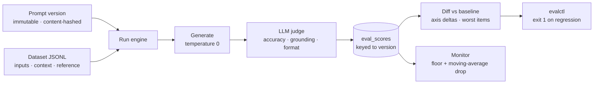

# LLM Eval & Prompt-Testing Platform

**Score every prompt version against a fixed dataset with an LLM judge, diff it against the version that's currently shipping, and fail CI when quality regresses — with every score traceable to an immutable prompt version in Postgres.**

Prompt changes are code changes without a test suite. This platform gives them one: register a prompt version, run it over a dataset, have a strict judge score each output on accuracy, grounding, and format, and compare the result with a baseline run. A small CLI, `evalctl`, wraps the whole flow and exits non-zero on a regression so a pipeline can block the merge.



## How it works

- **Immutable, deduplicated prompt versions.** A new template is a new row with an incrementing version; re-registering the same template returns the existing version, because versions are unique on `(prompt, sha256(template))`.
- **Safe template rendering.** `{placeholder}` substitution uses a regex rather than `str.format`, so braces in data can't break rendering, and a missing input is an explicit error.
- **A strict, three-axis judge.** The judge returns JSON scores for accuracy (vs. the reference), grounding (every claim supported by the context), and format. Scores are clamped to [0, 1] and combined with weights 0.5 / 0.3 / 0.2. Unparseable judge output becomes a zero verdict rather than crashing the run.
- **Runs survive bad items.** A generation or judge failure records a zero for that item and the run continues.
- **Regression diff.** Comparing two runs of the same dataset yields per-axis deltas, the five biggest per-item drops, and a verdict: `regressed` if the overall score falls more than 0.02 below the baseline.
- **Production monitor.** For a prompt's recent runs, flags the latest if it's below an absolute floor of 0.65 or more than 0.05 below the average of the previous five.

## Verified behavior

Exercised against PostgreSQL 16 with the bundled `alt-text.jsonl` dataset and a stubbed model whose judge returns fixed scores:

```text
same template registered twice → same version (v1)
baseline run:  n_items=3  accuracy=0.90  grounding=1.0  format=1.0  overall=0.95
candidate run: overall=0.80
diff:     overall_delta=-0.15 → regressed
monitor:  flagged — "dropped 0.15 below baseline 0.95"
```

## CLI

```bash
cd sdk          # requires httpx
python -m evalctl.cli eval \
  --name alt-text-generator --task summarize \
  --prompt-file path/to/prompt.txt --model gpt-4o-mini \
  --dataset-name alt-text --dataset-file ../backend/datasets/alt-text.jsonl \
  --judge-model gpt-4o \
  --baseline-run <current-shipping-run-id>
```

It registers the version, imports the dataset, runs the eval, diffs against the baseline, prints the overall delta and worst items, and exits `1` on a regression.

## API

| Method | Path | Description |
|---|---|---|
| `POST` | `/prompts/versions` | Register a prompt version `{prompt_name, task, template, model, notes?}` |
| `GET` | `/prompts/versions/{id}` | Fetch a version |
| `POST` | `/datasets/import` | Import JSONL `{name, task, jsonl}`; idempotent on `item_key` |
| `POST` | `/runs` | Run a version over a named dataset with a judge model |
| `POST` | `/diff` | Compare `baseline_run_id` and `candidate_run_id` |
| `GET` | `/monitor/{prompt_name}` | Quality-drop check across recent runs |

## Running the backend

Requires Python 3.10+, PostgreSQL, and `OPENAI_API_KEY`.

```bash
git clone https://github.com/AliAzamat/llm-eval-prompt-testing-platform.git
cd llm-eval-prompt-testing-platform/backend
pip install fastapi uvicorn "psycopg[binary]" psycopg_pool pydantic openai

createdb evalplatform
export DATABASE_URL=postgresql:///evalplatform OPENAI_API_KEY=<your key>
uvicorn app.main:app --reload     # applies schema.sql on startup
```

## Layout

| Path | Purpose |
|---|---|
| `backend/app/models/schema.sql` | `prompts`, `prompt_versions`, `datasets`, `dataset_items`, `eval_runs`, `eval_scores` |
| `backend/app/generation/` | Template rendering and generation |
| `backend/app/judge/` | Rubric prompt, verdict weights, judge call |
| `backend/app/services/` | Run engine, diff engine, monitor |
| `backend/app/repositories/` | SQL for prompts, datasets, runs |
| `backend/app/api/` | Pydantic contracts and routes |
| `backend/datasets/alt-text.jsonl` | Three-item alt-text dataset, including a decorative image whose correct alt text is empty |
| `sdk/evalctl/` | HTTP client and CLI |
